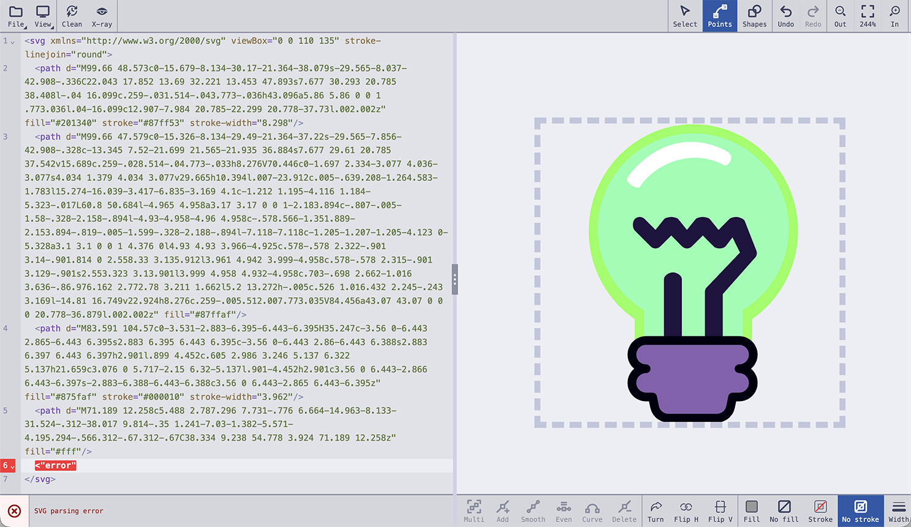
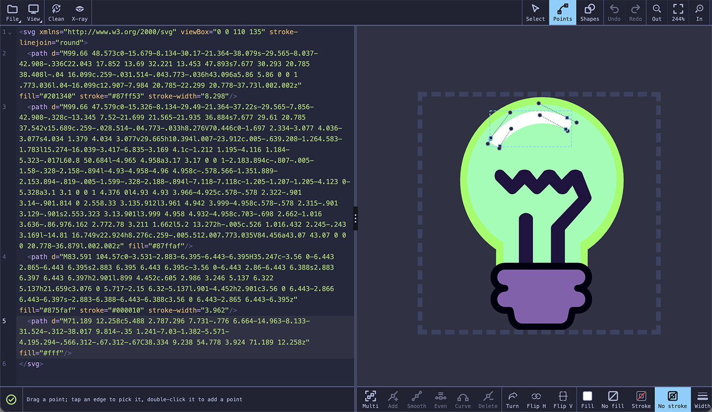

# SlickSVG - Split Screen SVG Editor
```
   ____     ____     ____ _______  _____   _____
 _/  _//__ |   /    /    V    __/__\    | /    /
_\___     \:   |    |    |    |/   Y    :/    /
\    |     |   |    |    |    |    |    /     \
|    :     |   |____|    |__  :    |    \      \
:____      |   :    /    |  \      |_____\ svg  \
     \____/ \______/ \__/    \____/       \_____/

        https://github.com/xero/slicksvg
```
A **Node.js**-based, web SVG editor written in **TypeScript**, with no frontend frameworks. The UI and all interactions are managed using vanilla TypeScript, DOM APIs, and modern browser features. The app provides a full-screen split view for editing and previewing SVG code in real time.

**Features**: Real-time editing • Resizable split view • Xray mode highlighting • Dark/light themes • SVG optimization • Transform tools • Mobile / Touch support • Comprehensive testing

## [Open SlickSVG in your browser](https://xero.github.io/slicksvg/)

## Screenshots

**Light Mode with an Error in the Code:**


**Dark Mode Editing Points:**


## Features

### Core Editor
- **Resizable Split View**: Editor and live preview with draggable separator for custom sizing (10%-90% range)
- **Advanced Code Editor**: [CodeMirror 6](https://codemirror.net/) with XML/SVG syntax highlighting and real-time linting. The line numbers take only the width the longest needs, one figure for a cleaned drawing on one line, and a line with an error has its number in red, with no gutter kept empty for errors. It opens with a light bulb drawn in paths, to try the tools on
- **Live Preview**: Instant SVG rendering with semi-transparent dashed border for bounding visualization
- **Real-time Validation**: XML/SVG syntax checking with detailed error reporting
- **Tokyo Night Themes**: Beautiful light/dark mode syntax highlighting with seamless theme switching

### Xray Mode
- **Visual Element Highlighting**: Toggle xray mode to visually highlight SVG elements in the preview when cursor is positioned within corresponding code
- **Native SVG Filters**: Uses sophisticated SVG filter effects for smooth, high-quality highlighting
- **Smart Element Detection**: Automatically detects cursor position and maps to corresponding SVG elements
- **Element Indexing**: Supports multiple elements of the same type (e.g., multiple circles, paths)
- **Non-intrusive**: Highlighting preserves original SVG appearance and doesn't modify code

### SVG Tools
- **Upload**: Drag & drop or click to upload SVG files with validation
- **Download**: Save current SVG code as a file
- **Resize**: Change SVG dimensions with modal dialog interface
- **Optimize**: The Clean button removes unnecessary whitespace and comments and optimizes the SVG code for smaller files, with every transform written in its simplest form
- **Transform**:
  - Rotate in 90° increments
  - Flip horizontal/vertical
  - Reset transformations

### Interactive Preview
- **Resizable Layout**: Drag the separator between editor and preview, by the grip in its middle or anywhere along it, to customize panel sizes in both horizontal and vertical modes. One toolbar runs across the top of the app, with the File and View menus, Clean, and X-ray at its start, and the modes, Undo and Redo, and the zoom at its end, so a pane squeezed almost away takes none of its buttons with it, and each pane ends in a strip as tall as that bar. The code's strip starts with an icon for the code: a green tick when it draws, a red cross on red when it has an error, and a dashed ring when it is empty. Beside it is the app's one message line, which says how to use the tool in hand, reads out a drag as it goes, and then says what was done or what went wrong. An error is said in red, and the code's own comes before any note or hint, which waits until the code is fixed; a tool's error still shows over it for a while. A message longer than three lines, or any with the code pane squeezed too narrow for it, rises over the foot of the drawing (or of the code, when the drawing is squeezed shorter), except the code's own error, which stays in its strip, cut to three lines, rather than cover the code it is about. The drawing's strip holds the drawing tools. While a pencil is down on the drawing, a touch on either bar is taken for the hand resting on the screen and presses nothing
- **Pan & Zoom**: Click and drag or scroll to pan; zoom with the In and Out buttons, Ctrl/Cmd+wheel, a trackpad pinch, or two fingers, about the spot under the pointer; the button between In and Out says how far in the view is, and goes back to the drawing's own size when pressed
- **Select**: Click an element in the preview to select it and its code; click again to walk into a group, Ctrl/Cmd+click to add or remove elements, Escape to clear
- **Modes**: Select, Points, and Shapes in the app bar say what a press on the drawing does, and the drawing's strip holds that mode's tools. Select picks and moves elements, with Clone, Delete, Turn, Flip H, Flip V, and To path at hand. Points edits points: tap any path, polygon, polyline, or line, inside a group too, and its points are the ones edited, as they are of whichever element the code's cursor moves into; the point tools sit in the strip with Turn and Flip for picked points, and To path for a shape that has none until it is a path. Shapes draws. Escape goes back to Select
- **Menus**: File holds Open, Save, and Size, and View holds the dark theme and the stacked layout, each row saying whether it is on; a button with a menu has a corner cut in. A menu closes when one of its items is pressed, its button is pressed again, or Escape is pressed, and a press anywhere else only closes it
- **Draw shapes**: In Shapes, the shape buttons in the drawing's strip at the foot of the preview take up a tool for each of SVG's basic shapes. For a rectangle, circle, ellipse, or line, drag across the drawing to draw it, over other shapes too (Shift makes a rectangle square, an ellipse round, or a line run at a multiple of 45 degrees; Alt draws from the middle out), or tap to place one a quarter the size of the drawing. A polyline, polygon, or path is drawn a point at a time: tap to place each point, which follows your finger or the pointer until you let go (Shift keeps it at a multiple of 45 degrees from the last), and with a mouse the next segment shows where the pointer is. The path tool is a pen: a tap places a corner, and a drag pulls a smooth curve out of the point; drag from the last point again to bend only the way out of it, leaving a corner there. Tap the first point to close the shape, or the last again (a double-click does it) to finish; Enter or the Done button finishes too, and Backspace, Mod+Z, or the Back button removes the last point. While a shape is under way the strip holds just its tool, Back, and Done, so they are in reach on a narrow screen, and you can zoom and pan between points. Each shape goes into the code as the drawing's last element, in the drawing's own units, rounded to what the zoom shows, and painted with the fill, stroke, and width last picked (see Paint): to begin with, grey filled when it closes round an area, and stroked grey a hundredth of the drawing wide when it is a line or left open. Then the tool is put down and the new shape is selected, ready for its handles or the point tools. Escape takes back a drag or lets a shape under way go, and the next Escape puts the tool down; pressing the tool again puts it down too, writing a shape under way that has points enough
- **Edit in the preview**: Drag the selection to move it, drag a corner handle to resize it in proportion or a side handle to stretch one axis (Shift swaps the two) or the top handle to rotate, nudge it with the arrow keys, Delete removes it, and the Clone button (or Ctrl/Cmd+D) makes a shifted copy with its own id. With several elements selected, one box goes round them all, and its handles scale them together from its far side or turn them together about its middle. Every edit is written into the code as a change to that element's own attributes, and undoes in one step. However moves, turns, resizes, and flips are mixed, an element's transform stays at most a translate, a rotate about its middle, and a scale (a mirror is a scale below zero), and a move changes only the translate. A path, polygon, or polyline with no transform moves its own points instead, so it gets none, unless a gradient, pattern, clip, mask, or filter it is drawn with is laid out in the drawing's units, which a transform carries along and its points would leave behind
- **Paint**: At the end of the drawing's strip, in every mode, are Fill, No fill, Stroke, No stroke, and Width. Fill and Stroke show the selection's paint as a swatch (struck through for none, and empty with a dashed edge for a gradient or pattern), and a press opens the browser's own colour picker; the colour picked shows on the selection as you move the picker (or the width slider), and goes into the code once, as one undo step, when you let it go, so even a large drawing keeps up. No fill and No stroke take the paint away, and pressed again give it back in the picker's colour. Width opens a popup with Behind, which puts the stroke under the fill (so the fill covers its inner half) as `paint-order: stroke` in the element's style, and pressed again takes it out, or says `normal` where a group or style sheet would still put it behind; and a slider over the widths that suit the drawing, from nothing to twenty times a new line's width, and a field to type any width. A paint goes where it shows: in an element's `style` when its style or a style sheet sets that paint (as Illustrator's exports do), and as an attribute otherwise. A group takes it, and so does anything inside it with a paint of its own, so the whole of it changes. What you pick also paints the shapes you draw next, and with nothing selected that is all it does: a closed shape takes the fill and the stroke, and a line or open shape only the stroke, or the fill's colour while there is no stroke, so no shape is drawn unseen
- **Edit points**: With a path, polygon, polyline, or line selected, press Enter, double-click it, or pick Points to edit its points. Drag anchors and curve handles (a press near a point takes hold of it, a fingertip's width on a touch screen), double-click the outline to add a point, and nudge one with the arrow keys. While you edit, the drawing's strip holds the point tools: tap the outline to pick a segment, then Add puts a point there and Curve turns a line into a curve (or a curve back into a line); Smooth makes the selected corner smooth, with its handles on one line, or a smooth point a corner; Symmetric makes it smooth with both handles one length; Delete removes the selected point, or puts a handle back into its anchor; and Select, or Escape, finishes. The select-several toggle at the start of the bar picks several points at once: tap points to add them or take them out, or drag across the drawing to take in the anchors inside; a tap elsewhere lets them go. Several points drag and nudge together, a box with handles round them scales and turns them together (each anchor's handles with it, so curves keep their shape), and Delete, Smooth, and Symmetric work on all of them (Ctrl or Cmd with a click adds a point too). Dragging one handle of a smooth point keeps the other in line (hold Alt to move it alone). To pull handles out of a corner, hold a finger on it for half a second and drag, or drag it with Alt held. Drag the outline itself to bend the segment there: the spot you hold follows the pointer, and a smooth join stays smooth. A polygon or polyline becomes a path when it gets a curve. The code changes only the numbers that moved, and keeps absolute and relative commands as they were
- **Rotate and flip the selection**: With elements selected, the Turn, Flip H, and Flip V buttons turn or mirror them together about the middle of the box round them all, the way the screen shows it even when the drawing is itself turned or flipped. With several points picked, the buttons turn or flip just those points about the middle of their box. With nothing selected they act on the whole drawing
- **Convert to path**: The To path button makes the selected rects, circles, ellipses, lines, polygons, and polylines (and those inside a selected group) paths that draw the same, keeping their other attributes, so their points can be edited. Round corners and circles become cubic curves, which every point tool can work on. There is no way back but undo
- **Touch Support**: Full multi-touch support: two fingers pinch-zoom the drawing (never the page) about the spot between them, one finger pans or drags; every toolbar button is a fingertip or more in size, its name under its icon, with a pressed one filled in the theme's accent from the top of the bar to the bottom; a toolbar too narrow for the names shows the icons alone, and one too narrow even for those scrolls
- **Responsive Design**: Adapts to different screen sizes and orientations
- **Visual Feedback**: Real-time zoom level announcements for accessibility

### User Experience
- **Dark/Light Mode**: Seamless theme switching with persistent preferences
- **Layout Toggle**: Switch between horizontal and vertical split layouts
- **Accessibility**: Full keyboard navigation, screen reader support, and ARIA labels
- **Error Handling**: Graceful error handling with user-friendly messages
- **Performance**: Optimized for smooth interactions and fast rendering

### Modern Development
- **TypeScript**: Strict type checking for better code quality and developer experience
- **Tailwind CSS**: Utility-first CSS framework for consistent styling
- **ESLint**: Code quality enforcement with TypeScript rules
- **Comprehensive Testing**:
  - **Vitest**: 111+ unit and integration tests
  - **Playwright**: End-to-end testing across browsers
- **Build System**:
  - **Vite**: Fast development server with hot reload
  - **ESBuild**: Optimized production builds

## Setup

> [!NOTE]
> You can use `bun` or `npm` (`bunx` / `npx`) interchangeably in all examples.
> For building, you may use the convenient shortcut: `bun bake` (same as `bun run build`).

1. Install dependencies:

    ```sh
    bun install
    ```

2. Start the development server:

    ```sh
    bun run dev
    # or
    npm run dev
    ```

3. Build the project (**single-file ready**):

    ```sh
    bun bake
    # or
    bun run build
    # or
    npm run build
    ```

    - This produces a single HTML file at `dist/index.html`.

4. Preview the built app:

    ```sh
    bun run preview
    # or
    npm run preview
    ```

    - Then open your browser to [http://localhost:4173](http://localhost:4173)

---

## Available Scripts

- `bun bake` — Build the app (shortcut for `bun run build`)
- `bun run dev` — Start Vite development server (port 5173)
- `bun run build` — Validate CSS, build single-file HTML (`dist/index.html`)
- `bun run preview` — Local preview of built app (port 4173)
- `bun run lint` — Run ESLint
- `bun run lint:fix` — Run ESLint with auto-fix
- `bun run test` — Run all unit and E2E tests
- `bun run test:all` — Run all tests with coverage
- `bun run test:unit` — Run unit tests only
- `bun run test:e2e` — Run E2E tests only (with local server)
- `bun run test:integration` — Run tests with coverage reporting

---

### Testing

The project includes both unit/integration tests and end-to-end (E2E) tests.

#### Unit and Integration Tests (Vitest)

- `bun run check` — Run unit tests (Vitest)
- `bun run check:coverage` — Run unit/integration tests with coverage

Test files are located in the `tests/` directory.

#### End-to-End Tests (Playwright)

- `bun run check:e2e` — Run E2E tests (Playwright, with local server)
- `bun run check:e2e:headed` — Run E2E tests with browser UI visible
- `bun run check:e2e:debug` — Debug E2E tests step by step
- `bun run check:e2e:ui` — Run E2E tests with Playwright's interactive UI

E2E tests are located in the `e2e/` directory.

##### Playwright Install

Before running E2E tests for the first time, install Playwright browsers and dependencies:

```sh
bun run playwright:install
bun run playwright:install-deps
```

---

#### Running All Tests

- `bun run test` — Run all unit and E2E tests
- `bun run test:all` — Run all tests with coverage
- `bun run test:unit` — Run unit tests only
- `bun run test:e2e` — Run E2E tests only
- `bun run test:integration` — Run tests with coverage

---

> [!NOTE]
> All scripts can be run with `bun run <script>` or `npm run <script>`.
> For building, `bun bake` is a shortcut for `bun run build`.

---

#### Test Setup

**First-time setup:**
```bash
# Install dependencies
bun install

# Install Playwright browsers (required for E2E tests)
bun run playwright:install

# If you encounter issues, also install system dependencies
bun run playwright:install-deps
```

**Development workflow:**
```bash
# Run tests during development
bun run check:watch          # Unit tests in watch mode
bun run check:e2e:headed     # E2E tests with browser visible

# Before committing
bun run test:all             # Full test suite with coverage
```

#### Test Configuration

- **Vitest config**: `vitest.config.ts` - Excludes E2E tests, includes coverage reporting
- **Playwright config**: `playwright.config.ts` - Runs tests against local dev server
- **Coverage**: Reports generated in `coverage/` directory (HTML, JSON, text formats)

#### Test Organization

```
tests/                       # Unit and integration tests (Vitest)
├── svg-editor-core.test.ts     # Core class functionality
├── svg-drag-resize.test.ts     # Drag-resize functionality and calculations
├── svg-transforms.test.ts      # Transform operations and SVG parsing
├── svg-error-handling.test.ts  # Error scenarios and edge cases
├── svg-accessibility.test.ts   # Accessibility features and integration
├── svg-upload.test.ts          # File upload functionality
├── svg-download.test.ts        # File download functionality
├── svg-optimization.test.ts    # SVG optimization features
├── svg-resolution-change.test.ts # Resolution modal and resizing
├── svg-fallback-sizing.test.ts # SVG sizing logic
├── svg-linting.test.ts         # SVG/XML linting functionality
├── svg-drag-drop-clear.test.ts # Drag & drop and clear functionality
├── view.test.ts                # Pan and zoom view maths
├── tokyo-night-theme-integration.test.ts # Tokyo Night theme integration
├── svg-xray.test.ts            # X-ray cursor-to-element lookup
├── source-map.test.ts          # Tag scanning, attribute edits, stamping
├── select.test.ts              # Preview selection picking and group walking
├── geometry.test.ts            # Move, resize, rotate, and flip planning
├── path-data.test.ts           # Path and polygon point editing
└── shapes.test.ts              # Shapes as path data, and the edit that makes one a path

e2e/                         # End-to-end tests (Playwright)
├── svg-editor.spec.ts          # Core editor functionality
├── svg-drag-resize.spec.ts     # Drag-resize E2E testing and accessibility
├── svg-upload.spec.ts          # Upload workflows
├── svg-accessibility.spec.ts   # Accessibility testing
├── svg-error-handling.spec.ts  # Error scenarios
├── svg-linting.spec.ts         # Linting integration tests
├── svg-drag-drop-clear.spec.ts # Drag & drop and clear functionality
├── svg-mobile-performance.spec.ts # Mobile, performance, compatibility
├── svg-xray.spec.ts            # X-ray mode highlighting
├── svg-history.spec.ts         # Undo, redo, and root-tag edits
├── svg-select.spec.ts          # Click-to-select, group walking, editor sync
├── svg-edit.spec.ts            # Drag, nudge, resize, rotate, flip, delete
├── svg-points.spec.ts          # Point editing mode
├── svg-cursors.spec.ts         # Handle, drag, and pan cursors
├── svg-to-path.spec.ts         # Converting shapes to paths
└── svg-zoom.spec.ts            # Wheel, trackpad, and touch pinch zoom
```

> **Note**: Keep test files in their respective directories to avoid runner conflicts. Vitest excludes the `e2e/` directory, and Playwright only looks in the `e2e/` directory.

For comprehensive testing instructions, setup details, and CI configuration, see [TESTING_GUIDE.md](./TESTING_GUIDE.md).

## Project Structure

```
src/
├── app.ts           # Main TypeScript application
├── source-map.ts    # Source text scanning, attribute edits, preview stamping
├── geometry.ts      # Move, resize, rotate, and flip planners
├── view.ts          # Pan and zoom about a point, wheel and pinch maths
├── path-data.ts     # Path and polygon points: parse, move, add, remove, smooth, curve
├── shapes.ts        # Rects, circles, ellipses, lines, and polygons as paths
├── select.ts        # Preview selection picking and box geometry
├── xray.ts          # X-ray cursor-to-element lookup
├── theme.css        # CSS styles with Tailwind
├── index.html       # Main HTML file
└── ico/             # Icon assets

tests/               # Unit and integration tests (Vitest)
├── svg-editor-core.test.ts     # Core class functionality
├── svg-drag-resize.test.ts     # Drag-resize functionality and calculations
├── svg-transforms.test.ts      # Transform operations and SVG parsing
├── svg-error-handling.test.ts  # Error scenarios and edge cases
├── svg-accessibility.test.ts   # Accessibility features and integration
├── svg-upload.test.ts          # File upload functionality
├── svg-download.test.ts        # File download functionality
├── svg-optimization.test.ts    # SVG optimization features
├── svg-resolution-change.test.ts # Resolution modal and resizing
├── svg-fallback-sizing.test.ts # SVG sizing logic
├── svg-linting.test.ts         # SVG/XML linting functionality
├── svg-drag-drop-clear.test.ts # Drag & drop and clear functionality
├── view.test.ts                # Pan and zoom view maths
├── tokyo-night-theme-integration.test.ts # Tokyo Night theme integration
├── svg-xray.test.ts            # X-ray cursor-to-element lookup
├── source-map.test.ts          # Tag scanning, attribute edits, stamping
├── select.test.ts              # Preview selection picking and group walking
├── geometry.test.ts            # Move, resize, rotate, and flip planning
├── path-data.test.ts           # Path and polygon point editing
└── shapes.test.ts              # Shapes as path data, and the edit that makes one a path

e2e/                 # End-to-end tests (Playwright)
├── svg-editor.spec.ts          # Core editor functionality
├── svg-drag-resize.spec.ts     # Drag-resize E2E testing and accessibility
├── svg-upload.spec.ts          # Upload workflows
├── svg-accessibility.spec.ts   # Accessibility testing
├── svg-error-handling.spec.ts  # Error scenarios
├── svg-linting.spec.ts         # Linting integration tests
├── svg-drag-drop-clear.spec.ts # Drag & drop and clear functionality
├── svg-mobile-performance.spec.ts # Mobile, performance, compatibility
├── svg-xray.spec.ts            # X-ray mode highlighting
├── svg-history.spec.ts         # Undo, redo, and root-tag edits
├── svg-select.spec.ts          # Click-to-select, group walking, editor sync
├── svg-edit.spec.ts            # Drag, nudge, resize, rotate, flip, delete
├── svg-points.spec.ts          # Point editing mode
├── svg-cursors.spec.ts         # Handle, drag, and pan cursors
├── svg-to-path.spec.ts         # Converting shapes to paths
└── svg-zoom.spec.ts            # Wheel, trackpad, and touch pinch zoom

dist/                # Built assets (generated)
├── theme.css        # Compiled CSS
├── app.js          # Bundled JavaScript
└── index.html      # HTML file
```

## Architecture

The application is built with modern web technologies:

- **CodeMirror 6** for the code editor with XML/SVG syntax highlighting and real-time linting
- **Tokyo Night themes** for beautiful light/dark mode syntax highlighting
- **Tailwind CSS** for utility-first styling with PostCSS processing
- **ESBuild** for fast TypeScript bundling (production builds)
- **Vite** for development server with hot reload and fast builds
- **Vanilla TypeScript** for all UI interactions and DOM manipulation
- **CSS Grid/Flexbox** for responsive layout system
- **Native SVG Filters** for xray mode highlighting effects
- **Modern Browser APIs** for drag & drop, touch events, and accessibility

## Usage

1. **Edit SVG Code**: Use the CodeMirror editor on the left to write/edit SVG markup with real-time syntax highlighting and error detection
2. **Live Preview**: See your changes instantly in the preview panel on the right
3. **Resize Layout**: Drag the blue separator between editor and preview panels to customize their sizes (10%-90% range)
4. **Upload Files**: Drag & drop SVG files onto the editor or use Open in the File menu
5. **Download Files**: Save your current SVG code as a file using Save in the File menu
6. **Transform SVGs**: Use the Turn, Flip H, Flip V, and Clean buttons to rotate, flip, or optimize your SVG
7. **Resize**: Choose Size in the File menu to change SVG dimensions via modal dialog
8. **Xray Mode**: Click the X-ray button to enable visual highlighting - move your cursor through different SVG elements in the code to see them highlighted in the preview
9. **Pan & Zoom**: Click and drag or scroll to pan the SVG; use the In and Out buttons, Ctrl/Cmd+wheel, or a pinch to zoom in/out about the pointer
10. **Select**: Click an element in the preview to select it and jump to its code; repeated clicks walk from a group into its parts, Ctrl/Cmd+click builds a multiple selection, and the box follows your cursor in the editor
11. **Edit points**: Select a path, polygon, polyline, or line and press Enter (or double-click it) to edit its points: drag them, double-click the outline to add one, tap the outline to pick a segment to add a point to or curve, Smooth to round a corner, Delete (or the Delete button in the drawing's strip) to remove one or retract a handle, Escape or Select to finish
12. **Edit in the preview**: Drag the selection to move it, drag a handle to resize or rotate it, use the arrow keys to nudge it, press Delete or the Delete button to remove it, or duplicate it with the Clone button or Ctrl/Cmd+D. The Turn and Flip buttons act on the selection when there is one, turning several elements or picked points together about their middle
10. **Dark Mode**: Toggle between light and dark themes with Dark theme in the View menu
11. **Layout Toggle**: Choose Stacked layout in the View menu to switch between horizontal and vertical layouts

## Development

The project uses modern development practices:

- **TypeScript** with strict type checking for better code quality
- **ESLint** with TypeScript rules for consistent code style
- **Vitest** for fast unit testing
- **Playwright** for reliable end-to-end testing
- **PostCSS** with Tailwind for efficient CSS processing

### Contributing

When adding tests, place them in the appropriate directory:
- Unit/integration tests → `tests/` (run with Vitest)
- End-to-end tests → `e2e/` (run with Playwright)

This separation prevents test runner conflicts and ensures tests run with the correct environment.

## Browser Support

Modern browsers supporting ES2022+ features:
- Chrome/Chromium 95+
- Firefox 93+
- Safari 15+
- Edge 95+

## License

[CC0 1.0 Universal](LICENSE) - Public Domain
